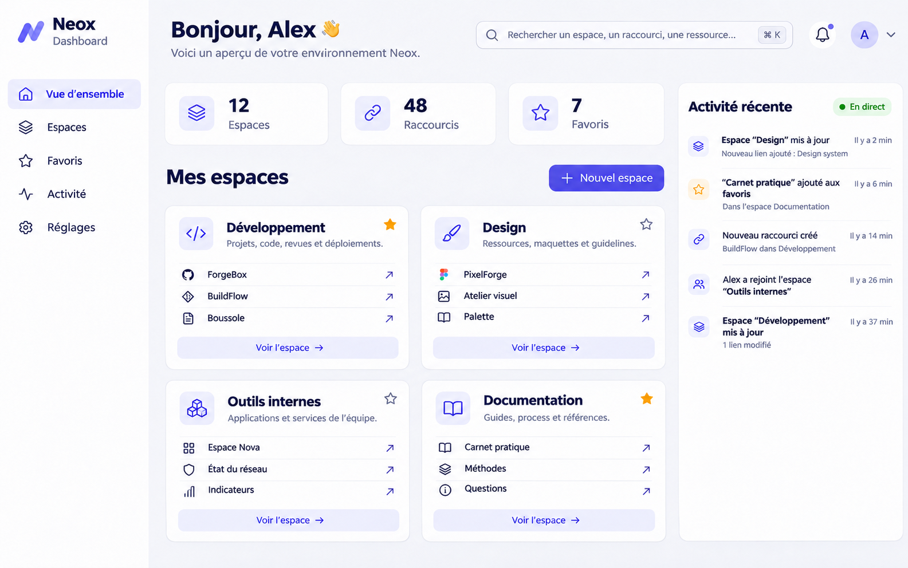

# Documentation Neox Board Bundle

Neox Board est un composant Symfony réutilisable pour organiser des liens vers des sites et outils, regroupés par espaces.

*Maquette d’illustration avec des noms de liens fictifs.*

## Documents

- **[Guide utilisateur](utilisateur/README.md)** — index des pages pour découvrir et utiliser Neox Board.
- [Architecture et périmètre](architecture.md)
- [Intégration et configuration prévues](integration.md)
- [Sécurité et données](security.md)
- [Cahier des charges produit et maquette](product-brief.md)

Le bundle fournit un dashboard Twig, des entités Doctrine, et des routes de gestion par propriétaire. Voir [l’intégration](integration.md) pour installer le schéma et activer les routes.

## Tests

Après installation des dépendances Composer, lancer `composer test` ou `vendor/bin/phpunit -c phpunit.xml.dist`.
