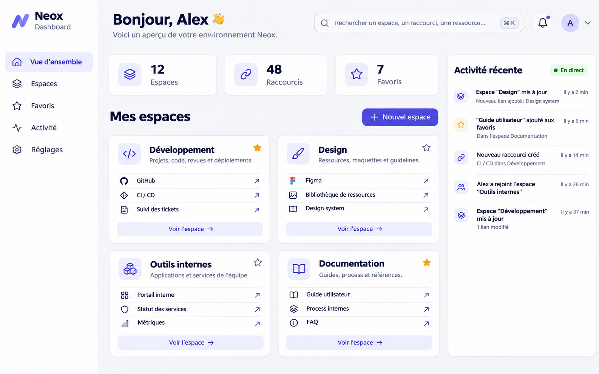

# Cahier des charges produit — Neox Board Bundle

## Objectif

Créer un bundle Symfony réutilisable, séparé de `NeoxDashBoardBundle`, installable via Composer et centré sur un composant dashboard personnalisable pour organiser des liens vers des sites et outils. L’interface utilise Symfony, Twig, Tailwind CSS, Preline et Turbo. Mercure et Messenger avec RabbitMQ fournissent des intégrations configurables pour le temps réel et l’asynchronisme.

## Phase de cadrage obligatoire

Avant toute implémentation fonctionnelle :

1. Inspecter les bundles déjà présents dans `Repo` pour relever conventions et fonctionnalités métier réutilisables, sans reprendre leurs défauts de sécurité ou d’architecture.
2. Proposer une architecture et un plan de réalisation détaillés, puis obtenir la validation du propriétaire du projet.
3. Fixer les versions Symfony, PHP et Doctrine supportées, et choisir la stratégie de compilation/distribution des assets.

## Fonctionnalités

- CRUD complet des entités du dashboard avec validation serveur et CSRF.
- Organisation en tableaux/espaces, sections, liens et widgets configurables.
- Favoris, recherche, historique récent et compteurs selon pertinence métier.
- Réordonnancement et déplacement accessibles au clavier et au tactile.
- Interfaces Turbo avec amélioration progressive et fonctionnement serveur lorsque JavaScript est absent, dans la mesure du possible.
- Mises à jour en direct via Mercure pour les changements partagés et résultats asynchrones.
- Traductions, templates et styles surchargeables par l’application hôte.

## Messenger, RabbitMQ et Mercure

- Utiliser Messenger pour les tâches qui ne doivent pas bloquer les requêtes.
- Documenter transports RabbitMQ, queues, workers, retries, délais et dead letters/échecs définitifs.
- Valider les messages et concevoir des handlers idempotents ; ajouter déduplication si le cas d’usage le demande.
- Émettre les événements Mercure après validation de la transaction, avec stratégie fiable évitant les notifications de changements annulés.
- Garder Messenger/RabbitMQ et Mercure désactivés par défaut et optionnels au chargement du bundle.
- Documenter variables d’environnement, URL du hub et clés JWT sans committer de secret.
- Limiter les topics Mercure aux droits de lecture/écriture du propriétaire ou tenant concerné.

## Sécurité et architecture

- Refuser par défaut l’accès anonyme aux routes de gestion ; rôle configurable.
- Isoler les données par utilisateur ou tenant et contrôler cette relation pour chaque opération, afin d’éviter les IDOR.
- Ne pas imposer de classe User à l’application hôte : proposer une intégration configurable.
- Protéger CSRF/XSS, valider strictement entrées, identifiants, tailles et URL.
- Toute récupération distante d’icône doit bloquer les réseaux privés/réservés et contrôler les redirections pour prévenir les SSRF.
- Contrôleurs minces, services injectés, formulaires et validateurs dédiés.
- Aucune modification automatique du schéma au chargement ; fournir une procédure d’installation/migrations documentée.

## Frontend et assets

- Interface responsive, moderne et sobre, avec états chargement/erreur, confirmations de suppression et retours accessibles.
- Tailwind/Preline selon une stratégie choisie et justifiée parmi AssetMapper/importmap ou build dédié.
- Ne pas imposer une chaîne front-end incompatible à l’application hôte.
- Respecter navigation clavier, focus visible, labels et contrastes ; rendre composants/templates/styles surchargeables.

## Qualité et livrables

- Tests unitaires et intégration HTTP pour CRUD, autorisations, CSRF, validation et isolation.
- Tests de handlers Messenger, erreurs/retries et publication Mercure via transports factices en CI.
- CI avec analyse statique, formatage, tests et matrice des versions Symfony supportées.
- Contraintes Composer bornées et testées ensemble ; lockfile uniquement si le dépôt devient une application de démonstration, pas pour la bibliothèque publiée.
- Bundle complet, documentation d’installation/configuration/sécurité/assets/Messenger/Mercure, exemple d’application hôte ou fixtures, commandes de test, limites connues et prochaines étapes.
- Ne pas publier ni déployer sans demande explicite.

## Référence visuelle

La maquette est une direction visuelle, pas une spécification pixel-perfect. Le produit reste principalement un organisateur de liens : espaces, favoris, recherche et activité sont visibles ; le temps réel est indiqué sobrement.

## État actuel

Le dépôt contient un squelette initial et cette spécification. La création de la maquette/spec ne signifie pas que les fonctionnalités CRUD, Doctrine, Turbo, Mercure ou Messenger sont déjà implémentées. L’architecture détaillée et le plan d’implémentation doivent être proposés pour validation avant de commencer cette réalisation.
