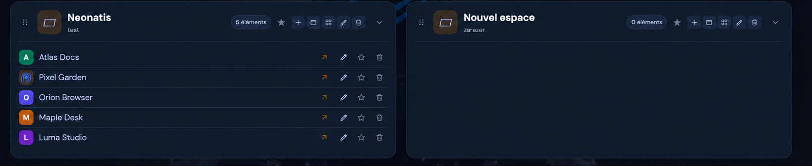

# Espaces

[← Index du guide utilisateur](README.md)

Un espace est une carte qui regroupe des raccourcis, des sections et des widgets. Son en-tête affiche son nom, sa description, le nombre d’éléments et ses commandes.

*Chaque carte peut être repliée indépendamment des autres.*

*Les titres de raccourcis visibles dans les captures sont des exemples fictifs.*

## Créer et modifier

Dans la Vue d’ensemble, utilisez **Créer mon premier espace** si le tableau est vide. Sur une carte, choisissez **Modifier** pour changer son nom ou sa description. La création et la modification utilisent le même formulaire.

## Ouvrir, replier et épingler

- Le chevron à droite de l’en-tête replie ou déplie le contenu de la carte. Chaque espace a son propre état : replier une carte ne replie pas les autres.
- L’étoile de l’en-tête ajoute ou retire l’espace des Favoris.
- La commande d’ouverture d’un favori affiche l’espace dans la zone principale.
- Le nombre dans l’en-tête comprend les liens, sections et widgets de l’espace.

Les états repliés sont mémorisés dans le navigateur. Les favoris sont enregistrés avec le tableau.

## Disposer les cartes en colonnes

La Vue d’ensemble présente deux colonnes. Faites glisser la poignée à points de l’en-tête d’une carte pour la déplacer dans la même colonne, vers l’autre colonne ou dans une colonne vide. Les zones de dépôt apparaissent pendant le déplacement. Le nouvel ordre et la colonne sont enregistrés et restent en place après rechargement.

Vous pouvez aussi déplacer une carte avec le clavier : placez le focus sur sa poignée, puis utilisez **Alt + ↑ / ↓** pour changer sa position, ou **Alt + ← / →** pour la passer dans l’autre colonne. La disposition s’effectue colonne par colonne ; les cartes d’une colonne n’intercalent pas leur ordre avec celles de l’autre.

Suite : [Organiser les espaces et les éléments](organisation.md) · [Liens et contenu](liens-et-contenu.md)
